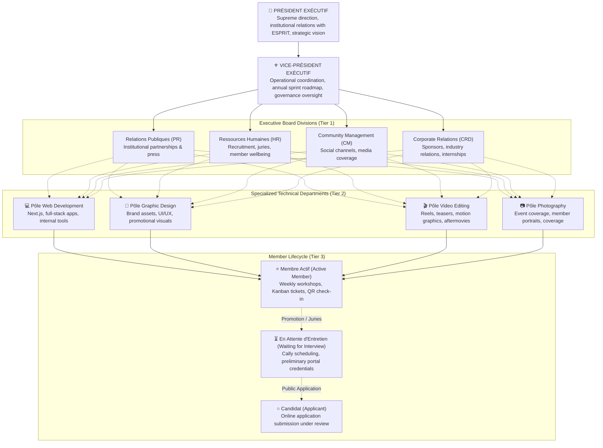
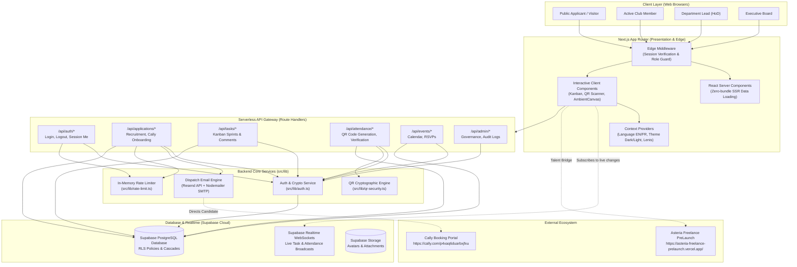

# Asteria Club Esprit — Operating System & Management Platform

<div align="center">


# ASTERIA CLUB ESPRIT
### Internal Operating System · Talent Incubator · Agile Sprint Engine

[](https://nextjs.org/)
[](https://react.dev/)
[](https://www.typescriptlang.org/)
[](https://tailwindcss.com/)
[](https://supabase.com/)
[](https://threejs.org/)
[](.github/workflows/ci.yml)
[](src/lib/constants.ts)

<p align="center">
  <a href="https://asteria-club-esprit.vercel.app"><b>🌐 Live Platform</b></a> •
  <a href="https://asteria-freelance-prelaunch.vercel.app/"><b>💼 Freelance Talent Bridge</b></a> •
  <a href="#-system-architecture"><b>🏗️ System Architecture</b></a> •
  <a href="#-programming-languages--tech-stack"><b>💻 Languages & Tech</b></a> •
  <a href="#-local-development-setup"><b>🚀 Quickstart</b></a> •
  <a href="#-api-reference"><b>📡 API Reference</b></a>
</p>

</div>

---

## 📖 Executive Summary & Mission

**Asteria Club Esprit** is the premier technical and creative student incubator at **ESPRIT (École Supérieure Privée d'Ingénierie et de Technologies, Tunis)**. 

This platform serves as the club's comprehensive internal operating system, designed to manage the entire student lifecycle:
1. **Recruitment & Admissions**: Multi-track candidate intake, portfolio review, automated email invitations, and interview slot booking via [Cally](https://cally.com/p4xaq6duarbxjfxu).
2. **Agile Sprint Execution**: A 4-stage Kanban workflow where members work on technical tickets and creative deliverables across 4 specialized divisions.
3. **Attendance & Event Health**: Dynamic QR code check-ins, passcodes, absence justifications, and real-time attendance auditing (minimum 75% assiduity threshold).
4. **Talent Incubation & Commercial Bridge**: Automated readiness scoring qualifying high-performing members for paid client projects on the **Asteria Freelance PreLaunch** platform.
5. **Multi-Tier Governance**: Secure Row-Level Security (RLS) policies and role-based permissions separating Executive Board, Department Leads (HoDs), Active Members, and Candidates.

---

## 💻 Programming Languages & Tech Stack

The platform is engineered using modern web technologies, strict type safety, responsive design, and scalable cloud infrastructure:

```
┌─────────────────────────────────────────────────────────────────────────────┐
│                           ASTERIA STACK COMPOSITION                         │
├────────────────────────────────┬────────────────────────────────────────────┤
│ TypeScript 5.7 (Full-Stack)    │ 100% strict type safety, zero `any` policy │
│ Next.js 16.3 (Turbopack)       │ React Server Components (RSC) + Route APIs │
│ React 19                       │ Modern hooks, concurrent rendering         │
│ PostgreSQL (Supabase Cloud)    │ RLS policies, triggers, realtime WebSocket │
│ Tailwind CSS 3.4               │ Design tokens, Asteria Charte 2026 palette │
│ Three.js & WebGL               │ Fluid 3D canvas background particles       │
│ Framer Motion 13               │ Fluid easing transitions (Vague, Courant)  │
│ Lenis 1.3                      │ Virtual momentum smooth scrolling          │
│ Resend API & Nodemailer SMTP   │ Automated transactional email failover     │
│ jsQR & QRCode                  │ Dynamic cryptographic QR attendance passes │
└────────────────────────────────┴────────────────────────────────────────────┘
```

### Deep Dive into Core Languages & Paradigms

#### 1. TypeScript (`.ts`, `.tsx`) — 100% Type-Safe Architecture
- **Strict Mode Enabled**: Explicit typing across all database schemas, API payloads, form submissions, and UI state.
- **Unified Domain Models**: Centralized in [`src/lib/types.ts`](src/lib/types.ts), providing shared contracts between frontend components and backend Route Handlers.
- **Supabase Typing**: Type-safe database queries via [`src/lib/supabase/types.ts`](src/lib/supabase/types.ts).

#### 2. React 19 & Next.js 16 (App Router) — Hybrid Server/Client Runtime
- **React Server Components (RSC)**: Layouts and data-fetching views rendered on the server to deliver instant initial page loads with zero unnecessary JavaScript sent to the browser.
- **Client Components (`"use client"`)**: Isolated to interactive UI widgets (Kanban drag-and-drop, dynamic QR code projector, live camera scanner, modal dialogs).
- **Turbopack Compiler**: Sub-second Hot Module Replacement (HMR) and optimized production compilation.
- **Next.js Middleware**: Edge-compatible session validation, protected route enforcement, and cookie token verification in [`src/middleware.ts`](src/middleware.ts).

#### 3. SQL & PostgreSQL (via Supabase Cloud) — Relational Data & Security
- **Row-Level Security (RLS)**: Enforced directly at the PostgreSQL database engine level so users can only view and modify records matching their authorization tier.
- **Triggers & Foreign Key Cascades**: Database-level `handle_new_user()` trigger auto-creates profile rows upon Supabase authentication.
- **Realtime Logical Replication**: Real-time subscriptions over WebSockets for task board status changes and check-in counts.

#### 4. Tailwind CSS 3.4 & PostCSS — Brand Design Tokens
- Configured in [`tailwind.config.ts`](tailwind.config.ts) to mirror **Asteria Charte Graphique 2026 (v2.1)**.
- Dark and light theme tokens, custom typography scales, and fluid water-inspired animation curves (`vague`, `courant`, `maree`).

#### 5. Three.js / WebGL — Ambient Generative Backgrounds
- An interactive dynamic 3D particle canvas ([`src/components/ui/AmbientCanvas.tsx`](src/components/ui/AmbientCanvas.tsx)) that reacts to viewport resizing and theme shifts, giving the Asteria platform its signature futuristic aesthetic.

---

## 🎨 Brand Identity (Charte Graphique 2026 · v2.1)

The platform strictly respects the official Asteria brand identity guidelines:

| Design Token | Value | Visual Purpose |
| :--- | :--- | :--- |
| **Primary Deep Teal** | `#0A3A40` | Main brand canvas, executive banners, dark cards |
| **Secondary Teal** | `#11606E` | Brand buttons, section headers, active accents |
| **Light Cyan Accent** | `#60C8D4` | High-contrast highlights, badges, link underlines |
| **Golden Amber** | `#E5A93C` | Priority tags, interview callouts, notifications |
| **Surface Light** | `#F4F9FA` | Dashboard background in light mode |
| **Surface Dark** | `#062327` | Deep dark mode background canvas |
| **Borders / Dividers** | `#D2E4E6` | Subtle structural division lines |

### Fluid Water Motion Curves
* **`Vague`** `cubic-bezier(0.16, 1, 0.3, 1)`: Modal entrances, card reveal sequences (300ms).
* **`Courant`** `cubic-bezier(0.65, 0, 0.35, 1)`: Tab switches, interactive state toggles (300ms).
* **`Marée`** `cubic-bezier(0.37, 0, 0.63, 1)`: Dismissals, drawer collapse, modal exits (500ms).

---

## 🏛️ Organizational Structure & Roles

The platform models Asteria's multi-tier governance structure:



---

## 🚀 Core Functional Modules

### 1. Multi-Persona Role-Based Access Control (RBAC)
- Built-in instant **Role Switcher Demo Bar** enabling seamless switching between Board, HoD, Member, and Applicant views for demonstration.
- Role-scoped data boundaries enforced at both frontend layout and backend API route levels.

### 2. Tailored Executive & Member Dashboards (`/dashboard`)
- **Executive Board Console**: Club-wide velocity metrics, task completion rate, attendance health benchmarks, financial and audit logs.
- **Head of Department (HoD) Console**: Track-specific sprint progress, department member roster, upcoming workshops, ticket assignment backlog.
- **Member Console**: Personal sprint ticket list, upcoming events RSVP status, attendance health percentage meter, and Freelance readiness score.

### 3. Agile Sprint Kanban Board (`/tasks`)
- 4-column agile sprint workflow: `TODO` ➔ `IN_PROGRESS` ➔ `REVIEW` ➔ `DONE`.
- Task attributes: Priority tags (`LOW`, `MEDIUM`, `HIGH`, `URGENT`), target technical department, assigned member, due dates.
- Threaded real-time commentary system for sprint feedback and code review notes.

### 4. Dynamic QR Attendance & Audit System (`/attendance`)
- **Rotating QR Projector**: Generates high-entropy dynamic QR codes on screen during sessions to eliminate spoofing and remote scanning.
- **Built-in Camera Scanner**: Uses `jsQR` for live video feed barcode scanning directly from browser.
- **6-Digit Backup Code**: Fallback PIN generation for members facing camera issues.
- **Absence Justification Portal**: Members submit doctor notes / academic justifications; reviewed and approved by Board/HoD.
- **Export Capabilities**: 1-click export of attendance reports for university administration.

### 5. Interactive Shared Calendar & RSVPs (`/calendar`)
- Full calendar visualization of workshops, meetings, hackathons, and guest podcasts.
- Real-time RSVP state tracking (`GOING`, `MAYBE`, `DECLINED`) with attendee counts and conflict warnings.

### 6. Interactive Org Chart & Department Hubs (`/departments`)
- Hierarchical interactive organizational tree visualizing Executive Board seats down to individual department rosters.
- Dedicated department hubs showcasing active sprint tickets, department description, and lead contact.

### 7. Member Directory & Talent Dossiers (`/members`)
- Filterable member catalog by department, technical skills, and freelance status.
- Individual member profile pages detailing completed tickets, verified attendance health %, bio, and connected GitHub/LinkedIn accounts.

### 8. Scoped Announcements & Discord Simulation (`/announcements`)
- Broadcast scoping: `CLUB` (all members), `DEPARTMENT` (restricted track), or `BOARD` (executive team).
- Pinned priority bulletins and a live preview of how the announcement appears when bridged to a Discord channel webhook.

### 9. Recruitment Pipeline & Automated Onboarding (`/apply` & `/applications`)
- Public candidate recruitment form collecting portfolio links, track preferences, and motivation statements.
- **Automated Interview Workflow**:
  - Setting status to `INTERVIEW` auto-creates a secure candidate profile with `WAITING_FOR_INTERVIEW` role.
  - Generates temporary login credentials for preliminary portal exploration.
  - Automatically dispatches a branded email featuring a **prominently highlighted Cally scheduling link**: `https://cally.com/p4xaq6duarbxjfxu` so candidates can select their exact interview date and time.
- **1-Click Member Onboarding**:
  - Setting status to `ACCEPTED` promotes the user to full `MEMBER` status, launches celebratory confetti, and sends official membership credentials.

### 10. Automated Email Dispatch Engine (`src/lib/email.ts`)
- Intelligent dual-transport architecture:
  1. **Resend REST API**: Primary high-deliverability cloud email service.
  2. **Direct SMTP Transport (Nodemailer)**: Automatic fallback routing via Gmail SMTP / custom mail server.
  3. **IPv4 Optimization**: Forced `family: 4` resolution to prevent serverless IPv6 connection timeouts.
- Branded, responsive cross-client HTML email templates for acceptances, interview convocations, and role promotions.

### 11. Internationalization (i18n) & Dual-Theme UI
- Instant dynamic language switching between **Français (FR)** and **English (EN)** powered by [`LanguageProvider`](src/components/providers/LanguageProvider.tsx).
- Complete dark and light theme support with persistent state stored in localStorage.

---

## 🏗️ System Architecture



---

## 📁 Repository Directory Structure

```
Asteria-Club-Esprit/
├── .github/
│   ├── workflows/
│   │   └── ci.yml                     # Automated GitHub Actions CI workflow
│   ├── ISSUE_TEMPLATE/
│   │   ├── bug_report.md              # Standardized bug reporting template
│   │   └── feature_request.md         # Structured feature suggestion template
│   └── pull_request_template.md       # Production pull request review checklist
├── public/
│   ├── logo.png                       # Asteria primary brand emblem
│   └── asteria-wave-logo.png          # Fluid wave identity asset
├── src/
│   ├── app/                           # Next.js 16 App Router hierarchy
│   │   ├── (dashboard)/               # Authenticated application shell
│   │   │   ├── admin/page.tsx         # System governance, cycles & audit logs
│   │   │   ├── announcements/page.tsx # Broadcast feed & Discord embed preview
│   │   │   ├── applications/page.tsx  # Recruitment pipeline & interview manager
│   │   │   ├── attendance/            # Attendance hub, QR scanner & passcodes
│   │   │   ├── calendar/page.tsx      # Interactive event calendar & RSVPs
│   │   │   ├── dashboard/page.tsx     # Role-customized analytics overview
│   │   │   ├── departments/           # Org chart & technical track hubs
│   │   │   ├── members/               # Member directory & detailed dossiers
│   │   │   ├── settings/              # Profile, passwords & connected accounts
│   │   │   ├── tasks/page.tsx         # 4-stage Agile sprint Kanban board
│   │   │   └── layout.tsx             # Authenticated shell layout (Sidebar/Header)
│   │   ├── api/                       # REST API Route Handlers
│   │   │   ├── admin/route.ts         # Cycle rollovers & audit records
│   │   │   ├── announcements/route.ts # Announcement CRUD & scope enforcement
│   │   │   ├── applications/          # Candidate intake, Cally booking emails
│   │   │   ├── attendance/            # QR validation, code check-in, excuses
│   │   │   ├── auth/                  # Login, logout, session verification
│   │   │   ├── connections/           # GitHub & social profile synchronization
│   │   │   ├── departments/           # Track details & org chart trees
│   │   │   ├── events/                # Calendar events & RSVP status
│   │   │   ├── members/               # Member dossier management & updates
│   │   │   ├── stats/route.ts         # High-level aggregate club KPIs
│   │   │   └── tasks/                 # Kanban task lifecycle & threaded comments
│   │   ├── apply/page.tsx             # Public student recruitment intake portal
│   │   ├── login/page.tsx             # Authenticated sign-in portal
│   │   ├── signup/page.tsx            # Account registration screen
│   │   ├── page.tsx                   # Public club landing page & showcase
│   │   ├── layout.tsx                 # Root HTML layout with context providers
│   │   └── globals.css                # Global styles, fonts & Tailwind utilities
│   ├── components/                    # Reusable React UI component library
│   │   ├── announcements/             # Announcements feed & modal creator
│   │   ├── attendance/                # QR projector, camera scanner modal
│   │   ├── brand/                     # Brand logo components & wave vector
│   │   ├── calendar/                  # Calendar grid view & RSVP selectors
│   │   ├── dashboard/                 # Board, HoD, and Member dashboard views
│   │   ├── kanban/                    # Kanban board, cards, task detail modals
│   │   ├── layout/                    # Header, Sidebar, MobileNav, PersonaBar
│   │   ├── org-chart/                 # Interactive SVG organizational chart
│   │   ├── profile/                   # Social connection cards & GitHub graph
│   │   ├── providers/                 # LanguageProvider, ThemeProvider, Lenis
│   │   ├── recruitment/               # ApplicationsPipeline & credentials modal
│   │   └── ui/                        # Button, Card, Badge, Modal, Input, Canvas
│   ├── hooks/                         # Custom React hooks (realtime subscriptions)
│   ├── lib/                           # Core utilities, services & domain models
│   │   ├── supabase/                  # Client, server & admin Supabase SDKs
│   │   ├── i18n/                      # English/French bilingual translation strings
│   │   ├── auth.ts                    # JWT token signing, verification & sessions
│   │   ├── constants.ts               # Brand colors, external links & Cally URL
│   │   ├── email.ts                   # Resend + Nodemailer dispatcher & HTML templates
│   │   ├── qr-security.ts             # Cryptographic QR token generator & validator
│   │   ├── rate-limit.ts              # API rate-limiting guard
│   │   ├── types.ts                   # Unified TypeScript domain definitions
│   │   └── utils.ts                   # Class merging (`cn`), date formatting
│   └── middleware.ts                  # Edge session validation & route guard
├── supabase/
│   └── migrations/                    # Version-controlled PostgreSQL SQL migrations
├── CONTRIBUTING.md                    # Guidelines for contributors
├── DOCUMENTATION.md                   # Detailed functional documentation
├── PROJECT_ARCHITECTURE_MAP.md        # Technical architecture specifications
├── SECURITY_AUDIT.md                  # Security hardening & audit sign-off
├── package.json                       # Project dependencies and build scripts
├── tailwind.config.ts                 # Design token configuration
└── tsconfig.json                      # Strict TypeScript compiler options
```

---

## 🗄️ Database Schema & Migrations

All database structures are version-controlled under `supabase/migrations/`:

| Migration File | Key Tables & Functionality |
| :--- | :--- |
| **`20260228_initial_schema.sql`** | Core relational schema: `profiles`, `departments`, `board_seats`, `events`, `rsvps`, `attendance_records`, `tasks`, `task_comments`, `announcements`, `applications`, `audit_logs`. Sets up the `handle_new_user()` trigger and initial RLS policies. |
| **`20260916_update_roles.sql`** | Upgrades role definitions to include `PRESIDENT`, `VICE_PRESIDENT`, `BOARD`, `HOD`, `MEMBER`, and `APPLICANT`. |
| **`20260930_add_profile_details.sql`** | Adds extended member profiles: student ID numbers, academic specializations, portfolio URLs, phone contacts. |
| **`20260930_performance_and_security.sql`** | Optimizes indexes on foreign keys (`department_id`, `assignee_id`), enforces strict Row-Level Security policies. |
| **`20261009_expand_applications_status.sql`** | Introduces `WAITING_FOR_INTERVIEW` and `DECLINED` statuses for the recruitment pipeline. |
| **`20261010_event_announcement_secure_attendance.sql`** | Implements secure attendance codes, rotating QR seeds, and excuse approval workflows. |
| **`20261011_add_student_email_to_applications.sql`** | Adds dual email support (`email` personal Gmail + `student_email` ESPRIT institutional). |
| **`20261011_connected_accounts_and_social_profiles.sql`** | Adds GitHub contribution graphs, LinkedIn links, and portfolio sync. |

---

## 📡 API Reference

All backend API routes return structured JSON responses with appropriate HTTP status codes:

### Authentication & Sessions
| Method | Endpoint | Description | Auth Level |
| :--- | :--- | :--- | :--- |
| `POST` | `/api/auth/login` | Authenticates user credentials & sets session cookie | Public |
| `POST` | `/api/auth/logout` | Clears active session cookie and invalidates token | Authenticated |
| `GET` | `/api/auth/me` | Retrieves active user session & current permissions | Authenticated |

### Recruitment Pipeline
| Method | Endpoint | Description | Auth Level |
| :--- | :--- | :--- | :--- |
| `GET` | `/api/applications` | Lists candidate applications with track filters | Board / HoD |
| `POST` | `/api/applications` | Submits new public membership application | Public |
| `PATCH`| `/api/applications/[id]` | Updates status (`INTERVIEW` / `ACCEPTED` / `REJECTED`), triggers Cally email | Board / HoD |
| `POST` | `/api/applications/[id]/onboard` | 1-Click provisional account creation & email dispatch | Board / HoD |

### Tasks & Agile Kanban
| Method | Endpoint | Description | Auth Level |
| :--- | :--- | :--- | :--- |
| `GET` | `/api/tasks` | Lists sprint tasks filtered by department or assignee | Authenticated |
| `POST` | `/api/tasks` | Creates a new technical sprint task | Board / HoD |
| `PATCH`| `/api/tasks/[id]` | Updates status column (`TODO` ➔ `IN_PROGRESS` ➔ `DONE`) | Assignee / Lead |
| `POST` | `/api/tasks/[id]/comments` | Adds a threaded comment or code review note | Authenticated |

### Attendance & Check-In
| Method | Endpoint | Description | Auth Level |
| :--- | :--- | :--- | :--- |
| `GET` | `/api/attendance` | Retrieves attendance records & health scores | Authenticated |
| `POST` | `/api/attendance/check-in` | Validates QR code or 6-digit numeric passcode | Authenticated |
| `POST` | `/api/attendance/justify` | Submits medical or academic absence justification | Member |
| `PATCH`| `/api/attendance/excuse/[id]` | Approves or rejects an absence justification | Board / HoD |
| `GET` | `/api/attendance/export` | Generates CSV export for academic administration | Board |

### Events & Announcements
| Method | Endpoint | Description | Auth Level |
| :--- | :--- | :--- | :--- |
| `GET` | `/api/events` | Retrieves upcoming workshops & meetings | Authenticated |
| `POST` | `/api/events/[id]/rsvp` | Submits member RSVP (`GOING`, `MAYBE`, `DECLINED`) | Authenticated |
| `GET` | `/api/events/[id]/qr` | Generates rotating dynamic QR code for host screen | Board / HoD |
| `GET` | `/api/announcements` | Retrieves announcements filtered by user scope | Authenticated |
| `POST` | `/api/announcements` | Publishes a new announcement bulletin | Board / HoD |

---

## 🚀 Quickstart & Local Setup

### Prerequisites
- **Node.js**: `v20.x` or higher
- **npm**: `v10.x` or higher
- **Supabase Account**: A free Supabase project at [supabase.com](https://supabase.com)

### 1. Clone the Repository
```bash
git clone https://github.com/itshydraaaaaa/Asteria-Club-Esprit.git
cd Asteria-Club-Esprit
```

### 2. Install Dependencies
```bash
npm install
```

### 3. Configure Environment Variables
Copy `.env.example` into `.env.local`:
```bash
cp .env.example .env.local
```

Fill in your configuration:
```env
# 1. Supabase Cloud Configuration
NEXT_PUBLIC_SUPABASE_URL="https://your-project.supabase.co"
NEXT_PUBLIC_SUPABASE_ANON_KEY="your-anon-key"
SUPABASE_SERVICE_ROLE_KEY="your-service-role-secret-key"

# 2. Application Domain
NEXT_PUBLIC_APP_URL="http://localhost:3000"

# 3. Session & Security
JWT_SECRET="generate-a-secure-random-32-byte-secret"

# 4. Email Delivery (Option A: Resend API)
RESEND_API_KEY="re_your_api_key_here"

# 5. Email Delivery (Option B: Gmail / Custom SMTP Fallback)
SMTP_HOST="smtp.gmail.com"
SMTP_PORT="465"
SMTP_SECURE="true"
SMTP_USER="your-email@gmail.com"
SMTP_PASS="your-google-app-password"
EMAIL_FROM="Asteria Club Esprit <onboarding@asteria.tn>"
```

### 4. Execute Database Migrations
Open your **Supabase Dashboard ➔ SQL Editor** and run the migration scripts located in [`supabase/migrations/`](supabase/migrations/) in chronological order (starting with `20260228_initial_schema.sql`).

### 5. Run Typecheck & Verification
```bash
# Validates 100% TypeScript type safety
npm run lint

# Builds the Next.js production bundle
npm run build
```

### 6. Start Development Server
```bash
npm run dev
```
Open **[http://localhost:3000](http://localhost:3000)** in your browser.

---

## 🔑 Demo & Test Accounts

For evaluation and demonstration purposes, use the instant **Role Switcher Demo Bar** at the top of the interface or log in using the credentials below:

| Persona | Name | Email Address | Password | Privileges |
| :--- | :--- | :--- | :--- | :--- |
| **President (Board)** | Yasmine Ben Ali | `president@asteria.tn` | `password123` | Full Super-Admin, All Departments, Governance |
| **VP (Executive)** | Aziz Trabelsi | `vp@asteria.tn` | `password123` | Executive Administration, Sprints, Audits |
| **HoD Web Dev** | Rayen Ayadi | `hod.web@asteria.tn` | `password123` | Web Dev Sprints, Member Roster, Juries |
| **HoD Graphic Design**| Maya Mahjoub | `hod.design@asteria.tn` | `password123` | Design Sprints, Asset Reviews, Juries |
| **Active Member** | Karim Chaabane | `karim.chaabane@asteria.tn`| `password123` | Personal Tasks, QR Pass, Event RSVPs |
| **Candidate** | Mehdi Bouazizi | `mehdi.applicant@esprit.tn`| `password123` | Restricted Portal, Interview Convocations |

---

## 💼 Commercial Bridge: Asteria Freelance PreLaunch

The core educational purpose of Asteria Club Esprit is preparing university students for commercial software and design contracts.

- **Platform URL**: [https://asteria-freelance-prelaunch.vercel.app/](https://asteria-freelance-prelaunch.vercel.app/)
- **Qualification Criterion**: When an active member delivers **5 or more sprint tickets** and maintains **≥ 75% attendance health**, their profile is automatically certified with the `freelanceReady: true` credential.
- **Client Deployment**: Certified members are highlighted on the freelance portal and matched with commercial client projects for paid software development, branding, and multimedia production.

---

## 🤝 Contributing

We welcome contributions from Asteria Club members and the ESPRIT student community! Please consult our [**CONTRIBUTING.md**](CONTRIBUTING.md) guide for details on:
- Branching strategies (`feat/`, `fix/`, `chore/`)
- Commit message standards (Conventional Commits)
- Typecheck verification (`npm run lint`)
- Pull request review guidelines

---

## 📄 License & Institutional Affiliation

- **Developed for**: **Asteria Club Esprit** · École Supérieure Privée d'Ingénierie et de Technologies (ESPRIT), Tunis, Tunisia.
- **License**: Released under the **MIT License**. See [LICENSE](LICENSE) for details.
- **Contact & Inquiries**: [contact@asteria.tn](mailto:contact@asteria.tn)

<div align="center">
  <br />
  <p><b>Asteria Club Esprit — Incubateur Technique & Créatif</b></p>
  <p><i>Façonner l'avenir technologique des étudiants d'ESPRIT.</i></p>
</div>
